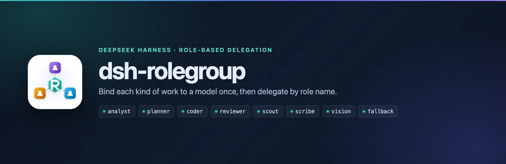
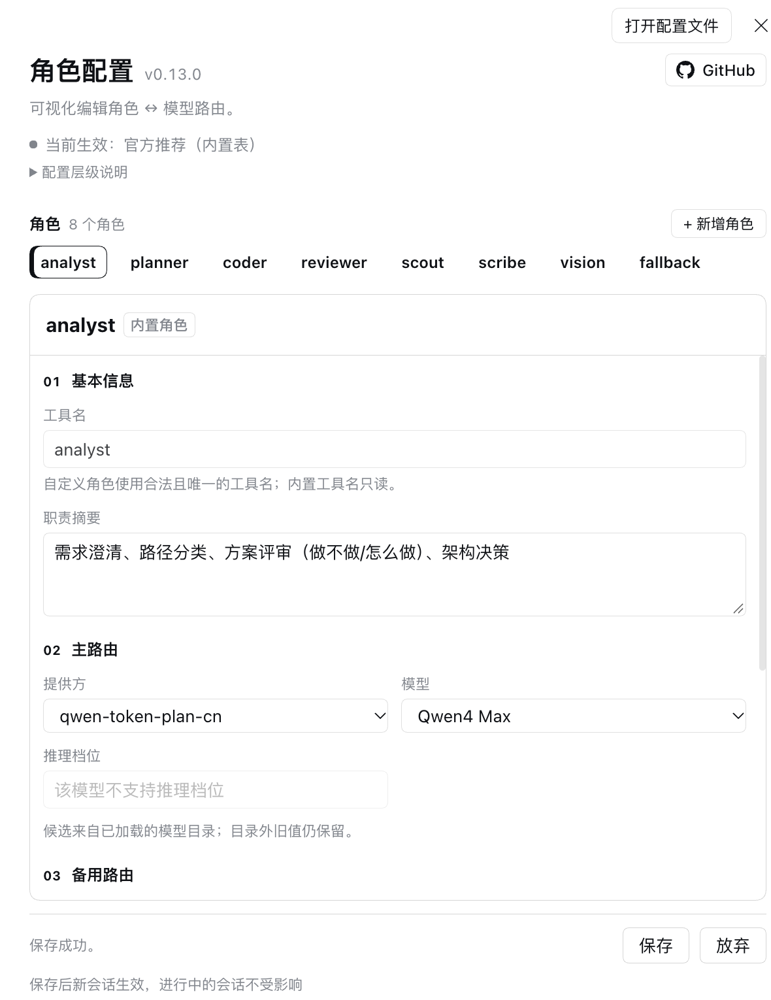

<p align="center">
  
</p>

<p align="center">
  <a href="README.md">简体中文</a> ·
  <a href="#contents">Contents</a> ·
  <a href="CHANGELOG.md">Changelog</a> ·
  <a href="MODELS.en.md">Models</a> ·
  <a href="LICENSE">MIT</a>
</p>

<p align="center">
  <a href="https://www.npmjs.com/package/dsh-rolegroup"></a>
  <a href="https://www.npmjs.com/package/dsh-rolegroup"></a>
  <a href="LICENSE"></a>
  = 0.2.1-rc.1">
  
</p>

> A community-maintained DeepSeek Harness (dsh) plugin, not an official DeepSeek product.
>
> This README describes **0.13.0**. Requires dsh **≥ 0.2.1-rc.1** (verified on 0.2.2-rc.5). The settings-page nav icon only shows on dsh ≥ 0.2.2-rc.5; everything else works on older releases.

## Contents

- [1. Overview](#1-overview)
- [2. Quick start](#2-quick-start)
- [3. Built-in roles](#3-built-in-roles)
- [4. Configuration](#4-configuration)
- [5. Settings panel](#5-settings-panel)
- [6. Diagnostics](#6-diagnostics)
- [7. Development](#7-development)
- [8. Credits](#8-credits)
- [9. License](#9-license)

## 1. Overview

dsh-rolegroup takes the question "which model should this kind of work use?" out of each delegation and turns it into a role: name, provider/model, persona. Define it once, then call the role name.

- **The role is the tool name**: eight built-in roles, `analyst` / `planner` / `coder` / `reviewer` / `scout` / `scribe` / `vision` / `fallback`; call the role name instead of writing `provider`/`model`.
- **Bind once, reuse everywhere**: a role carries its primary route, reasoning effort, fallback chain, and persona; changing the model is a configuration change, not a call-site change.
- **Two configuration layers**: the built-in table (factory defaults) and optional panel overrides; a panel save applies to new sessions, not in-flight work.
- **Fallbacks and diagnostics**: built-in roles carry DeepSeek fallback chains; `/rolegroup doctor` lists each effective route, availability, and repair hints.
- **Delegation only, no orchestration**: one-off specialist delegation; DAGs, multi-round collaboration, and state stay with Agent Teams or other plugins.

| | Input | It handles | Limit |
|---|---|---|---|
| Bare `subagent` | provider/model every time | nothing | you have to remember the model |
| **Agent Teams** (official; 智能体团队) | task DAG / roster | who does what, dependencies, multi-round work | teammates inherit the root model; no per-member model binding |
| **dsh-rolegroup** | roles, defined once | which model this kind of work uses | one-off specialist delegation; no orchestration |

They solve different problems. Agent Teams coordinates the work; rolegroup picks the model for a single delegation. The two can coexist in one deployment. A common pattern is to split expensive and cheap work: `reviewer` on a cheap model, `coder` on a strong one, with Agent Teams still doing the coordination.

<details>
<summary><b>Scope: what we deliberately do not do</b></summary>

| We do not | Why |
|---|---|
| **Register an MCP server** | Dozens of tools inflate the tool list, the permission surface, and the prompt budget |
| **Write a project-level state directory** (`.rolegroup/`) | We route work; we are not a runtime state machine — state belongs to the orchestration layer |
| **Take over the main session's Agent Preset** | An explicit preset replaces the parent composition; taking over means choosing for the user |

When you need orchestration, state, or an MCP tool chain, compose other plugins — they do not replace this one.

</details>

## 2. Quick start

Requires dsh ≥ 0.2.1-rc.1; the commands below use the `web` profile.

### Official plugin manager

```sh
dsh plugin --profile web add dsh-rolegroup
```

You can also open the Plugins page, click "Add plugin", choose "Install a third-party plugin", enter `dsh-rolegroup`, and click "Install". Restart `dsh web` after installing.

If a third-party market rewrite drops the plugin, add it again. You can also search for `dsh-rolegroup` in the Plugin Market and install it — same flow underneath.

### From source

For development or local changes:

```sh
git clone https://github.com/zhouxnsz/dsh-rolegroup.git
cd dsh-rolegroup
npm install --omit=peer
npm run link:deps
dsh plugin --profile web add "link:$PWD"
```

`--omit=peer` installs the esbuild devDependency without pulling the peer `@deepseek-ai/schemastery` in as a real copy; `link:deps` then symlinks the deployment's schemastery into this repo, which the Settings panel needs for source installs. The reverse order breaks: a plain `npm install` puts a real copy there first, and `link:deps` **does not overwrite** an existing real directory. If you already have one, delete `node_modules/@deepseek-ai/schemastery` and rerun `link:deps`.

<details>
<summary>Alternative install: mount on the home layer (only to survive profile rewrites)</summary>

```sh
ln -sfn "$PWD" ~/.dsh/profiles/web/node_modules/dsh-rolegroup
cat >> ~/.dsh/cordis.patch.yml <<'YAML'
- insert:
    - id: dsh-rolegroup
      name: 'dsh-rolegroup'
YAML
```

The home layer survives profile rewrites, but it does not show up under "Installed" and has no toggle. Pick one; do not use both.

</details>

### Verify

```sh
dsh --profile web --dump-config | grep -A1 dsh-rolegroup   # should show - id: dsh-rolegroup
```

Restart `dsh web` and open a new session. The eight role tools should be in the tool list; you can also run `/rolegroup doctor` from the new session.

### Delegate by role

Type:

```
/rg <task>
```

The plugin injects the task plus a "delegate by role" directive into the main session; the main model then picks from the roles registered on this machine, writes briefs, and dispatches. `/rolegroup work <task>` is the long alias. `/rg` is main-session only — child sessions get an error. It only triggers; whether to dispatch is still the main model's call.

After changing code, restart and open a new session. For panel saves, see §5.

## 3. Built-in roles

With no override, the plugin registers these eight roles. The table shows the built-in initial values; the panel can override them.

The table names models only: one model usually has several routes (subscription plan, pay-as-you-go, gateway), and the provider is up to your configuration. The built-in default points at the built-in table's providers (the author's subscriptions) — on your machine run `/rolegroup init` to generate routes that actually work, or edit them in the panel. Model ids and the effective routes are whatever `/rolegroup doctor` prints.

| Role | Built-in model | Responsibility |
|---|---|---|
| `analyst` | Qwen4 Max | Requirement clarification, path classification, plan review (do it / how), architecture decisions |
| `planner` | Kimi K3.1 Pro | Plan design: file layout, task breakdown, interface contracts, writing the plan document |
| `coder` | Kimi K3.1 Pro | Implementation: follow the steps of the plan/spec document supplied in the brief and report evidence per step |
| `reviewer` | Qwen3.8 Flash | Closing review: check acceptance criteria against evidence (was it actually done) |
| `scout` | DeepSeek V4.1 Flash | Exploration and bulk search (returns `file:line` evidence) |
| `scribe` | Qwen3.8 Flash | Documentation backfill, reports, spec maintenance |
| `vision` | Qwen3.8 Flash | Vision: image analysis, UI review, prototype reading, OCR (**the bound model must accept images**) |
| `fallback` | DeepSeek V4.1 Flash | Catch-all for unclassified lightweight tasks |

### Recommended bindings

See **[MODELS.en.md](./MODELS.en.md)** for the built-in default model per role.

### Delegation quality

Roles do not inherit the parent session's conversation history or the bodies of skills already loaded there. The role preset recomposes the project `AGENTS.md` instructions and skill catalog for the child session's cwd, so the brief still needs to be self-contained. The more specific the brief, the more usable the result. The plugin gives the main model a fixed template in the system prompt:

- A brief should state: background, goal, constraints, acceptance, known facts (`file:line`), claims to verify;
- Factual conclusions need verifiable evidence: `file:line` for code, command and output for runtime results, region/coordinates for images, and original sources for external facts; quote verbatim, and unreproducible facts are marked UNVERIFIED;
- Do not prescribe the expected verdict distribution ("should be all true / should find problems"). The 2026-11-16 comparison showed this wording makes `analyst` compress partially-true claims into `TRUE` and fabricate quotes; the neutral briefs quoted verbatim.
- A subagent's conclusion is input, not a verdict. Spot-check quotes; do not adopt a confident report that cannot show evidence.

Fallback chains apply only when a role configuration provides fallbackModels; an explicitly configured role without that field does not inherit the built-in chain. The degraded and model-unadvertised warnings can coexist, and preflight risk names the actual fallback route.

Use `scout` for code location and fact-finding, `reviewer` for acceptance-criteria closing review, and `analyst` for design judgement. For implementation, use `coder` when a structured plan or spec already exists (with its path supplied in the brief); if no plan has been formed, you may delegate to `planner` first.

#### Working with specification-driven workflows

These are usage conventions, not a built-in OpenSpec integration.

- For OpenSpec, the main session should pass `coder` the `changeRoot` returned by `status`, plus the `contextFiles`, required context, and each task's `sourcePath` / `line` returned by `instructions apply`, rather than only the change name;
- When several `coder` agents run in parallel, only the main session checks off items in task status files; each `coder` changes code and tests only. With one `coder` working serially, it can check items off as directed by the apply skill;
- `openspec validate <change> --strict` checks structure. It does not replace verify or prove that specs were left unchanged; inspect `git diff` for spec changes.

## 4. Configuration

Two layers: the built-in table (factory defaults) and panel overrides (optional). A panel save applies to new sessions; `rolegroup.jsonc` is no longer a configuration source.

| Layer | What it is | When to use it |
|---|---|---|
| Built-in table | The eight factory bindings | Works with no configuration |
| Panel override | The table saved under Settings → 角色配置 | Change provider/model/persona |

### Fallback chains

Built-in roles ship a chain that only targets the two DeepSeek providers dsh bundles: **`deepseek-account` (account login) first**, since that is what most users have, then `deepseek-official` (API key):

```jsonc
"analyst": {
  "provider": "qwen-token-plan-cn",
  "model": "qwen4-max",
  "fallbackModels": ["deepseek-account/deepseek-flash", "deepseek-official/deepseek-flash", "deepseek-official/deepseek-v4-pro"]
}
```

## 5. Settings panel

- **Entry**: Settings → 角色配置.
- **Layout**: role list on the left, one-role editor on the right; one role at a time.
- **Drafts**: switching roles keeps every draft; only Save writes the table, and saved routes apply to new sessions.
- **Disabled state**: Save and Discard are disabled while there are no unsaved changes; edit any field to enable them. Use the X in the top-right to close the panel.
- **Custom roles**: removable from the list or the editor; built-in roles have no remove control.
- **Fallback routes**: read-only in configured order, with an explicit empty-chain message; they show saved configuration, not the route actually used at runtime.
- **Failures**: validation, write, and conflict failures keep the draft so you can fix it and retry, or discard it explicitly.

<p align="center">
  
</p>

<sub><i>Settings → 角色配置: one role at a time; switching keeps every draft, and the save bar stays visible.</i></sub>

## 6. Diagnostics

`/rolegroup doctor` reads the `$DSH_HOME/plugins/dsh-rolegroup/last-startup.json` snapshot and compares it with the live llm service. It lists each role's name, bound model, provider, and whether the model is available, with repair hints when something is wrong. When a built-in fallback is in effect it says so ("primary X unavailable, using built-in fallback Y").

| Command | What it does |
|---|---|
| `/rolegroup doctor` | Diagnose the current bindings and availability |
| `/rolegroup init` | Print the current effective bindings as JSONC (nothing written) |
| `/rg <task>` | Inject the delegate-by-role directive (main session) |

> On a fresh machine, run `/rolegroup doctor` first to see which roles' primary routes are unavailable; change bindings in the panel.

Example:

> If a role's provider is not registered, an error block is appended below the table and the provider is marked ❌. The role is not registered. This matters most for a fallback role: a skipped fallback route does not exist. The built-in `fallback` role uses `deepseek-official` because that provider is always registered:

```
❌ fallback：provider "example-provider" 当前未注册（在用：deepseek-official, kimi-coding, qwen-token-plan-cn）
   修复：① 检查该适配器的 key/额度；② 或在面板里把 fallback 改用已注册 provider。
```

```
dsh-rolegroup doctor — 8 个在册角色
analyst  qwen-token-plan-cn/qwen4-max    ✅  ✅
planner  kimi-coding/k3.1-pro              ✅  ✅
…
✅ 无异常
```

Also: a snapshot older than 7 days, or one that looks hand-edited, gets a ⚠️ but the table is still printed; when the llm service is down the availability column shows ➖.

## 7. Development

```sh
npm install --omit=peer  # esbuild devDependency, without schemastery as a real copy
npm run link:deps        # symlink the deployment's schemastery into this repo
npm test                 # offline smoke suite (plain Node); pretest runs link:deps
npm run build:client     # after editing src/client/** or lib/roles.js
```

For the install order and why, see §2 "From source". Without `npm install`, `npm test` fails with `ERR_MODULE_NOT_FOUND: esbuild`. Without `link:deps`, dsh prints `无法使用部署树的 @deepseek-ai/schemastery …` at startup and the plugin runs host-only: role tools still work, but the Settings section is missing. `pretest` runs `link:deps` automatically, but it likewise does not overwrite an existing real copy.

Layout:

| Path | Contents |
|---|---|
| `lib/` | Host side: `index.js` (composition/recomposition), `roles.js` (role table and merge), `config.js` (settings `Config`), `settings-table.js` (override table ↔ section), `init.js` (`/rolegroup init` export), `doctor.js`, `command.js` |
| `src/client/` | Client sources (`controller.js` / `card.jsx` / `locales.js` / `meta.js`); `lib/client.js` is the esbuild artifact and must be rebuilt after edits |
| `tests/` | Offline smoke suite (plain Node, no browser) |
| `scripts/` | `build-client.mjs` (esbuild bundle; injects the `package.json` version) and `link-deployment-deps.mjs` (environment symlink) |
| `locale/` | Plugin metadata: `meta.title` and `meta.description` in `en.json` / `zh.json`, shown by the Plugins page and the Plugin Market |

## 8. Credits

The role (category) to model binding, the persona convention, and the rule that role subagents cannot delegate again are inspired by [oh-my-openagent](https://github.com/code-yeongyu/oh-my-openagent) ("omo"). The model pairings are not copied from omo; this plugin's bindings are decided by its own configuration and evaluation.

More dsh plugins: [Awesome DSH Plugin](https://github.com/awesome-dsh-plugin/awesome-dsh-plugin).

## 9. License

MIT © Zhou.XiaoNing. See [LICENSE](LICENSE).
