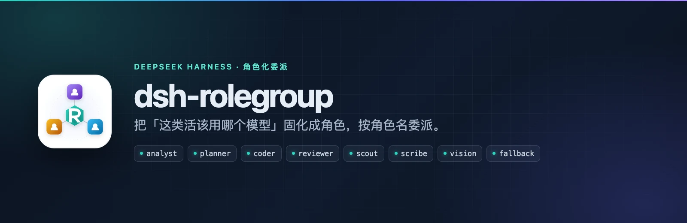
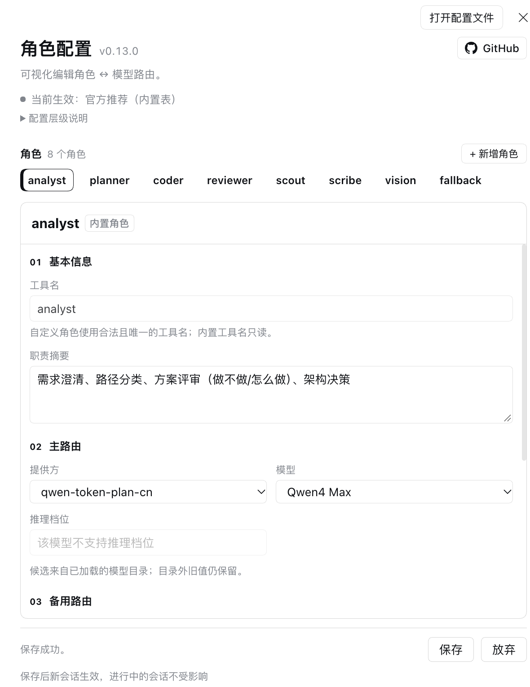

<p align="center">
  
</p>

<p align="center">
  <a href="README.en.md">English</a> ·
  <a href="#目录">目录</a> ·
  <a href="CHANGELOG.md">更新日志</a> ·
  <a href="MODELS.md">模型表</a> ·
  <a href="LICENSE">MIT</a>
</p>

<p align="center">
  <a href="https://www.npmjs.com/package/dsh-rolegroup"></a>
  <a href="https://www.npmjs.com/package/dsh-rolegroup"></a>
  <a href="LICENSE"></a>
  = 0.2.1-rc.1">
  
</p>

> 社区维护的 DeepSeek Harness（dsh）插件，不是 DeepSeek 官方产品。
>
> 本文描述 **0.13.0**。要求 dsh **≥ 0.2.1-rc.1**（实测 0.2.2-rc.5）；设置页导航图标只在 dsh ≥ 0.2.2-rc.5 上显示，其余功能不受影响。

## 目录

- [1. 功能概览](#1-功能概览)
- [2. 快速开始](#2-快速开始)
- [3. 内置角色](#3-内置角色)
- [4. 配置](#4-配置)
- [5. 设置面板](#5-设置面板)
- [6. 诊断](#6-诊断)
- [7. 开发](#7-开发)
- [8. 参考与致谢](#8-参考与致谢)
- [9. License](#9-license)

## 1. 功能概览

dsh-rolegroup 把「这类活该用哪个模型」从每次委派里拿出来，固化成一个角色：名字、provider/model、persona 写一次，之后按角色名调用。

- **角色即工具名**：内置 8 个角色，`analyst` / `planner` / `coder` / `reviewer` / `scout` / `scribe` / `vision` / `fallback`；委派时直接调用角色名，不用再写 `provider`/`model`。
- **一次绑定，多处复用**：角色配置包含主路由、推理档位、备用链和 persona；换模型只改配置，不用改调用方。
- **两层配置**：内置表（出厂默认）+ 设置面板覆盖；面板保存只对新会话生效，进行中的会话不受影响。
- **可降级、可诊断**：内置角色带 DeepSeek 备用链；`/rolegroup doctor` 逐项列出实际路由、可用性和修复建议。
- **只做委派，不抢编排**：单次专家委派；DAG、多轮协作、状态仍交给官方智能体团队或其它插件。

| | 输入 | 它负责 | 限制 |
|---|---|---|---|
| 裸 `subagent` | 每次手写 provider/model | 无 | 每次都要记模型名 |
| **智能体团队**（Agent Teams，官方） | 任务 DAG / 名单 | 分工、依赖、多轮协作 | teammate 继承 root 模型，不能逐成员绑模型 |
| **dsh-rolegroup** | 一次定义角色 | 这类活交给哪个模型 | 只做单次专家委派，不负责编排 |

三者不冲突。智能体团队负责编排，rolegroup 负责单次委派的模型选择，两者可以在同一部署里同时使用。常见做法是把贵活和便宜活分开：`reviewer` 用便宜模型，`coder` 用强模型，编排还是交给智能体团队。

<details>
<summary><b>边界：我们明确不做什么</b></summary>

| 不做 | 为什么 |
|---|---|
| **不注册 MCP server** | 几十个工具会把工具列表、权限面、prompt 预算一起撑大 |
| **不写项目级状态目录**（`.rolegroup/`） | 我们做的是「路由」，不是「运行时状态机」；状态属于编排层 |
| **不接管主会话的会话模式（Agent Preset）** | 显式 preset 会替换父组合，接管等于替用户做选择 |

需要编排、状态、MCP 工具链时，请组合其它插件——它们与本插件互不替代。

</details>

## 2. 快速开始

要求 dsh ≥ 0.2.1-rc.1；下面的命令使用 `web` profile，按实际环境替换。

### 官方插件管理器

```sh
dsh plugin --profile web add dsh-rolegroup
```

也可以在「插件」页 →「添加插件」→「安装第三方插件」，填 `dsh-rolegroup`，点「安装」。装好后重启 `dsh web`。

如果第三方市场重写 profile 把插件清掉，重新 `add` 一次即可；也可以在「插件市场」搜索 `dsh-rolegroup` 安装，走同一套流程。

### 从源码安装

开发或需要改代码时：

```sh
git clone https://github.com/zhouxnsz/dsh-rolegroup.git
cd dsh-rolegroup
npm install --omit=peer
npm run link:deps
dsh plugin --profile web add "link:$PWD"
```

`--omit=peer` 装 devDependency esbuild，不把 peer `@deepseek-ai/schemastery` 装成真实副本；随后 `link:deps` 把部署树的 schemastery 软链进来，设置面板需要它。顺序反过来会踩坑：普通 `npm install` 先装出真实副本，之后 `link:deps` 遇到真实目录**不覆盖**。已有真实副本时删掉 `node_modules/@deepseek-ai/schemastery` 再跑一次 `link:deps`。

<details>
<summary>备用安装：挂到 home 层（仅绕过 profile 重写时使用）</summary>

```sh
ln -sfn "$PWD" ~/.dsh/profiles/web/node_modules/dsh-rolegroup
cat >> ~/.dsh/cordis.patch.yml <<'YAML'
- insert:
    - id: dsh-rolegroup
      name: 'dsh-rolegroup'
YAML
```

home 层不会被 profile 重写覆盖，但不会出现在「已安装」组，也没有启停开关。两种方式选一个，不要同时用。

</details>

### 验证

```sh
dsh --profile web --dump-config | grep -A1 dsh-rolegroup   # 应出现 - id: dsh-rolegroup
```

重启 `dsh web`，开一个新会话。工具列表里应该出现 8 个角色工具；也可以在新会话里跑 `/rolegroup doctor`。

### 按角色委派

在会话里输入：

```
/rg <任务>
```

插件会把任务和一段“按角色委派”的指令注入主会话；主模型据此从本机在册角色中选择、写简报并派发。`/rolegroup work <任务>` 是长别名。`/rg` 只主会话可用，子会话调用会被拒绝；它只负责触发，是否派发仍由主模型判断。

改代码后需要重启并开新会话。面板保存怎么生效，见 §5。

## 3. 内置角色

没有任何覆盖时，插件会注册这 8 个角色。下表是内置初值，可以在面板里覆盖。

表里只写**模型名称**：同一个模型往往有多条路由（订阅套餐、按量计费、聚合网关），具体 provider 由你的配置决定。内置默认绑定指向内置表里的 provider（作者的订阅），在你的机器上可用 `/rolegroup init` 生成一套本机可用的路由，或在面板里直接改。模型 ID 与实际生效路由以 `/rolegroup doctor` 为准。

| 角色 | 内置绑定模型 | 职责 |
|---|---|---|
| `analyst` | Qwen4 Max | 需求澄清、路径分类、方案评审（做不做/怎么做）、架构决策 |
| `planner` | Kimi K3.1 Pro | 计划设计：文件结构、任务拆分、接口契约、计划文档落笔 |
| `coder` | Kimi K3.1 Pro | 编码执行：按计划/规格文档步骤实现并回填证据 |
| `reviewer` | Qwen3.8 Flash | 收口审查：逐项核对验收标准与证据（做没做到） |
| `scout` | DeepSeek V4.1 Flash | 探索定位、批量搜索（返回 `文件:行号` 证据） |
| `scribe` | Qwen3.8 Flash | 文档回填、报告、spec 维护 |
| `vision` | Qwen3.8 Flash | 看图：图片分析、UI 评审、原型识别、OCR（**要求绑定模型支持图片输入**） |
| `fallback` | DeepSeek V4.1 Flash | 未分类的轻量任务兜底 |

### 推荐绑定

各角色的内置默认模型见 **[MODELS.md](./MODELS.md)**。

### 委派质量

角色不继承父会话的对话历史或已加载的技能正文；项目 `AGENTS.md` 和技能目录由角色 preset 按子会话 cwd 重新组合，简报仍需自包含。简报越具体，返回越可用。插件在系统提示里给主模型一段固定模板：

- 简报至少写：背景、目标、约束、验收、已知事实（文件:行号）、待核验命题；
- 事实性结论必须有可核验依据：代码事实给文件:行号，运行结果给命令与输出，图片给区域/坐标，外部事实给原始来源；引用逐字，无法复现的按 UNVERIFIED 处理；
- 不要预设结论分布（不要写「应该全真/应该有问题」）。2026-11-16 的对照显示，这种写法会让 `analyst` 把部分成立的命题压成 `TRUE` 并编造引用；中性简报逐字准确。
- 子任务结论是输入，不是裁决；主模型要抽查引用，重结论轻证据的回报不要直接采纳。

备用链仅在角色配置提供 fallbackModels 时生效；显式配置的角色没写这个字段时，不继承内置链。降级与模型未广告预警可并存，预检风险使用实际备用路由。

代码定位与事实取证用 `scout`；带验收标准的收口核对用 `reviewer`；设计判断用 `analyst`。实现任务已有结构化计划或规格时用 `coder`（路径随简报给出），未形成计划的可先派 `planner`。

#### 与规格驱动工作流配合

以下是使用约定，不是插件内置的 OpenSpec 集成。

- OpenSpec 示例：主会话把 `status` 返回的 `changeRoot`，以及 `instructions apply` 返回的 `contextFiles`、必需 context、任务的 `sourcePath` / `line` 等交给 `coder`，不要只给 change 名；
- 多个 `coder` 并行时，主会话独占任务状态文件的勾选，`coder` 只改代码和测试；串行使用单个 `coder` 时，可由它按 apply 技能勾选；
- `openspec validate <change> --strict` 只做结构检查，不替代 verify，也不能证明 specs 没被修改；specs 差异应看 `git diff`。

## 4. 配置

配置有两层：内置表（出厂默认）和面板覆盖（可选）。面板覆盖保存后对新会话生效；`rolegroup.jsonc` 不再是配置来源。

| 层 | 内容 | 什么时候用 |
|---|---|---|
| 内置表 | 8 个角色的出厂绑定 | 不配置时直接可用 |
| 面板覆盖 | 「设置 → 角色配置」保存的整张表 | 改 provider/model/persona |

### 备用模型链

内置角色都带一条链，只指向 dsh 自带的两个 DeepSeek provider：**账号登录的 `deepseek-account` 优先**（普通用户更可能只有登录态），其次 API Key 的 `deepseek-official`：

```jsonc
"analyst": {
  "provider": "qwen-token-plan-cn",
  "model": "qwen4-max",
  "fallbackModels": ["deepseek-account/deepseek-flash", "deepseek-official/deepseek-flash", "deepseek-official/deepseek-v4-pro"]
}
```

## 5. 设置面板

- **入口**：设置 → 角色配置。
- **布局**：左侧角色列表，右侧单角色编辑器；一次只编辑一个角色。
- **草稿**：切换角色不丢草稿；只有点「保存」才写入整张表，保存后对新会话生效。
- **禁用态**：没有未保存修改时「保存」「放弃」禁用；改任意字段后启用。关闭面板用右上角 X。
- **自定义角色**：可从列表或编辑器删除；内置角色没有删除入口。
- **备用路由**：按配置顺序只读展示，空链有说明；它们表示保存的配置，不表示运行期实际采用了哪条。
- **失败处理**：校验、写入或冲突失败时保留草稿，可修正后重试或显式放弃。

<p align="center">
  
</p>

<sub><i>设置 → 角色配置：一次编辑一个角色；切换角色保留草稿，底部保存栏常显。</i></sub>

## 6. 诊断

`/rolegroup doctor` 会读取 `$DSH_HOME/plugins/dsh-rolegroup/last-startup.json` 快照，再和运行时的 llm 服务比对，逐项列出角色名、绑定模型、provider 和模型是否可用；有异常时附上修复建议。内置备用档生效时，doctor 会写明「主路由 X 不可用，已用内置备用档 Y」。

| 命令 | 作用 |
|---|---|
| `/rolegroup doctor` | 诊断当前绑定与可用性 |
| `/rolegroup init` | 打印当前生效绑定（JSONC，不写文件） |
| `/rg <任务>` | 注入按角色委派指令（主会话） |

> 新机器上第一次用，先跑 `/rolegroup doctor` 看哪些角色的主路由在本机不可用；想换绑就在面板里改。

示例：

> 如果某个角色的 provider 没有注册，表下面会多一段错误，并把这一行的 provider 标成 ❌。这个角色不会被注册。兜底角色尤其要注意：被跳过的兜底路由等于不存在。内置的 `fallback` 绑在 `deepseek-official` 上，就是因为这个 provider 一定会注册：

```
❌ fallback：provider "example-provider" 当前未注册（在用：deepseek-official, kimi-coding, qwen-token-plan-cn）
   修复：① 检查该适配器的 key/额度；② 或在面板里把 fallback 改用已注册 provider。
```

```
dsh-rolegroup doctor — 8 个在册角色
analyst  qwen-token-plan-cn/qwen4-max    ✅  ✅
planner  kimi-coding/k3.1-pro              ✅  ✅
…
✅ 无异常
```

另外：快照超过 7 天或看起来被改过会标 ⚠️，表格照常输出；llm 服务不可用时可用性列标 ➖。

## 7. 开发

```sh
npm install --omit=peer  # 装 devDependency esbuild，不把 schemastery 装成真实副本
npm run link:deps        # 把部署树的 schemastery 软链进来
npm test                 # 离线 smoke suite（Node 直跑）；pretest 会自动跑 link:deps
npm run build:client     # 改了 src/client/** 或 lib/roles.js 后重建 lib/client.js
```

安装顺序和原因见 §2「从源码安装」。不跑 `npm install`，`npm test` 会报 `ERR_MODULE_NOT_FOUND: esbuild`。不跑 `link:deps`，dsh 启动时会打印 `无法使用部署树的 @deepseek-ai/schemastery …`，插件降级成 host-only：角色工具还能用，设置页那一节会缺席。`pretest` 虽然自动跑 `link:deps`，但同样不会覆盖已存在的真实副本。

目录：

| 路径 | 内容 |
|---|---|
| `lib/` | 宿主侧：`index.js`（装配/重组装）、`roles.js`（角色表与合并）、`config.js`（settings `Config`）、`settings-table.js`（覆盖表 ↔ section）、`init.js`（`/rolegroup init` 导出）、`doctor.js`、`command.js` |
| `src/client/` | 客户端源码（`controller.js` / `card.jsx` / `locales.js` / `meta.js`）；`lib/client.js` 是 esbuild 产物，改完要重建 |
| `tests/` | 离线 smoke suite（Node 直跑，不需要浏览器） |
| `scripts/` | `build-client.mjs`（esbuild 打包，注入 `package.json` 的版本号）、`link-deployment-deps.mjs`（环境软链） |
| `locale/` | 插件元数据：`en.json` / `zh.json` 里的 `meta.title` 与 `meta.description`，供插件页与插件市场显示本地化名称和说明 |

## 8. 参考与致谢

角色（类别）到模型的绑定方式、persona 约定，以及角色子代理不能再委派这条约束，参考了 [oh-my-openagent](https://github.com/code-yeongyu/oh-my-openagent)（omo）。模型搭配没有照搬 omo 的结论；本插件的绑定按自己的配置和评测决定。

更多 dsh 插件见 [Awesome DSH Plugin](https://github.com/awesome-dsh-plugin/awesome-dsh-plugin)。

## 9. License

MIT © Zhou.XiaoNing。见 [LICENSE](LICENSE)。
